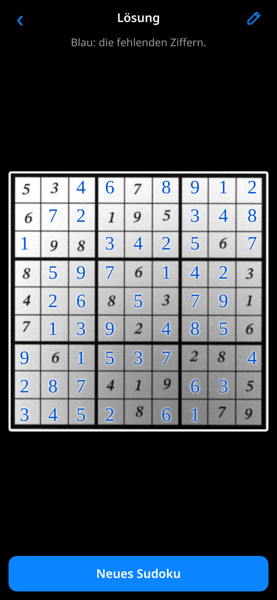

# Sudokufoto

Photograph a sudoku with your phone and see the solution instantly.

[](https://github.com/michaelkrisper/sudokufoto/actions/workflows/ci.yml)
[](LICENSE)
[](package.json)
[](https://michaelkrisper.github.io/sudokufoto/)

**Live: https://michaelkrisper.github.io/sudokufoto/**

An installable web app (PWA) for Android and iPhone. Recognition and solving
run entirely on the device. The user interface is in German.



## Features

- **Live camera with auto capture:** hold the sudoku in view; as soon as it is
  recognised with a unique solution, the solution appears. A shutter button
  and picking a photo from the gallery work too.
- **Rotated or tilted photos:** the perspective is rectified, landscape and
  upside-down shots are detected.
- **Handwriting:** in a puzzle someone already started, pencil and pen entries
  are told apart from the printed digits, and wrong entries are pointed out.
- **Review and correct:** uncertain digits are marked, every cell can be
  changed with a keypad, and puzzles can be entered entirely by hand.
- **Solution in the photo:** the missing digits are drawn into the rectified
  photo.
- **Offline:** a network-first service worker caches the app shell.

## How it works

Vanilla JavaScript, no build step, no runtime dependencies.

| File                       | Role                                                                                                                                                                                       |
| -------------------------- | ------------------------------------------------------------------------------------------------------------------------------------------------------------------------------------------ |
| `js/detect.js`             | Adaptive threshold, connected components, grid as the largest quadrilateral on the convex hull, verified by its line pattern; rectification by homography; cuts out the digit in each cell |
| `js/ocr.js`, `js/model.js` | Small neural network (576 -> 128 -> 9, int8 weights, ~100 KB) that classifies the digits                                                                                                   |
| `js/hand.js`               | Print vs. handwriting from stroke height, relative darkness and colour; the solver has the final say                                                                                       |
| `js/read.js`               | Full pipeline including orientation (the rotation with the most confidently read digits wins)                                                                                              |
| `js/solver.js`             | Bitmask backtracking solver; detects ambiguous and unsolvable puzzles                                                                                                                      |
| `js/worker.js`             | Runs recognition in a Web Worker so the camera preview stays smooth                                                                                                                        |

The network is trained on digits from **synthetic phone photos**
(`tools/synth.py`: random sudokus in more than 100 fonts with perspective,
rotation, shadows, blur, noise and JPEG artefacts), cut out with exactly the
same JavaScript code the app uses. Validation uses font families never seen in
training.

## Privacy

Photos never leave the device: there is no server component, no upload, no
account and no tracking.

## Development

Requires Node 24, and Python 3 with Pillow and NumPy for the tests (they render
synthetic photos).

```sh
pip install -r tools/requirements.txt
npm install
npm run serve          # http://localhost:8792
npm test               # solver, handwriting split and recognition on synthetic photos
npm run lint           # Biome
npm run check          # lint + tests
```

End-to-end test in headless Chrome with a fake camera (needs `google-chrome`):

```sh
npm run serve &
npm run test:e2e       # or: node scripts/e2e.mjs <url> [screenshot-dir]
```

Measuring recognition and retraining the network:

```sh
tools/synth.py /path/test --n 100 --turns        # test photos (PGM + cases.json)
node tools/eval.mjs /path/test --verbose
tools/synth.py - --n 300 --fonts train | node tools/extract.mjs train-1.bin   # repeat with other --seed
tools/synth.py - --n 300 --fonts test  | node tools/extract.mjs val.bin
python3 tools/train.py train-*.bin --val val.bin  # writes js/model.js
```

Every push to `main` runs lint and tests; only if they pass is the site
deployed to GitHub Pages.

## License

[MIT](LICENSE)
